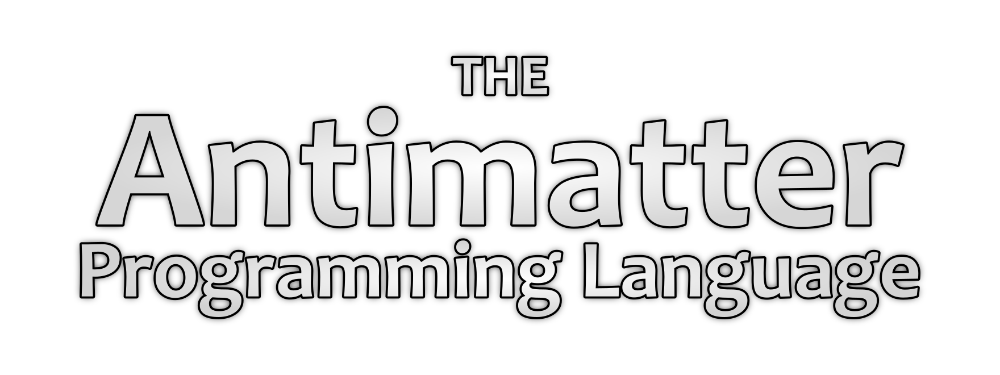

 

 A high-performance systems programming language focused on simplicity, Mutable Value Semantics, and Copy-on-Write memory management. 
 

## Status

Antimatter is currently in active development. The lexer and parser are complete, while the semantic checker, compiler pipeline, and code generation are still being built.

> **Latest Update:** [Engineering Log #2](https://github.com/arshalaromal/antimatter/discussions/11)

## The Core Concept

Antimatter is designed to remove the need for a garbage collector while keeping the language practical, predictable, and easy to use. It aims to combine performance, safety, and simplicity in a single system.

* **Native Primitives:** No heap overhead for `Int`, `Float`, `Bool`.
* **CoW Memory:** Automatic safety via reference counting and deep-copy-on-mutation.
* **Zero-Cost Borrows:** Immutable, stack-only pointers for function arguments.
* **Cycle Handling:** Cyclic references are handled using an `@weak` compiler directive to prevent memory leaks.

## Error Handling Philosophy

Antimatter also aims to introduce a new and simpler way of managing errors. The goal is to make error handling more structured, more expressive, and less painful without adding unnecessary runtime cost.

## Technical Architecture

* **Runtime:** Rust-based memory management layer.
* **Backend:** Emits QBE IR for efficient native code generation.

---

*Note: This is an active research project. The design and implementation are subject to change as the language evolves.*
